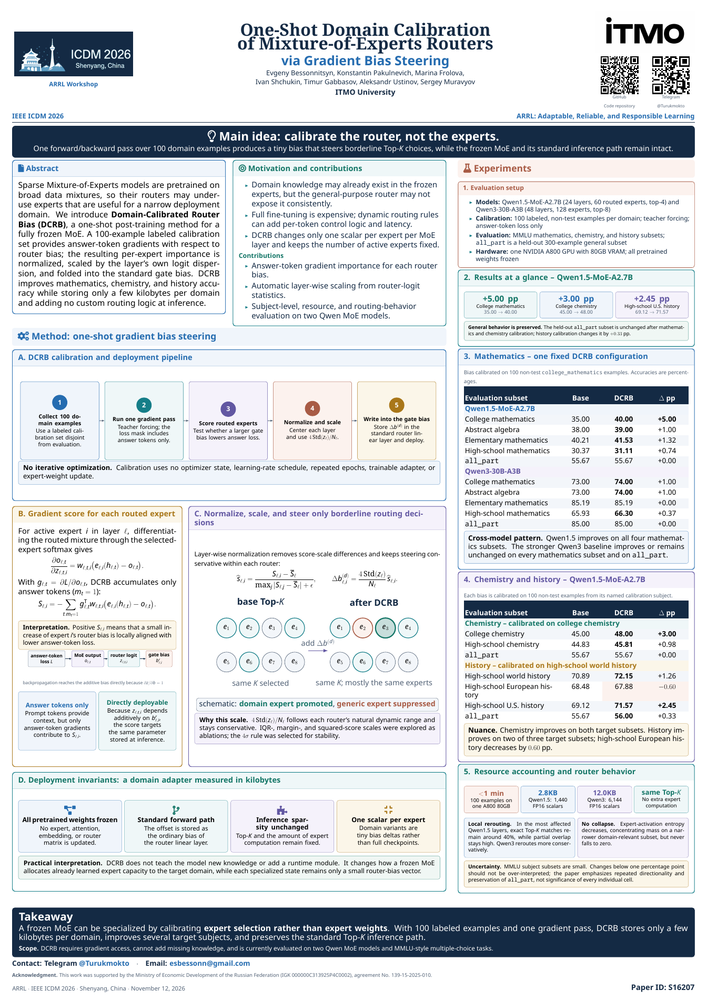

# One-Shot Domain Calibration of Mixture-of-Experts Routers

**Gradient Bias Steering · DCRB · ARRL Workshop at IEEE ICDM 2026 · Paper S16207**

Specialize a frozen mixture-of-experts model by calibrating its router: one gradient pass on a small labeled domain set produces a per-expert bias, which is folded into the router's existing linear layer. Expert weights and the standard Top-K inference path are preserved.

**Authors (as listed on the poster):** Evgeny Bessonnitsyn, Konstantin Pakulnevich, Marina Frolova, Ivan Shchukin, Timur Gabbasov, Aleksandr Ustinov, Sergey Muravyov. **Affiliation:** ITMO University.

## Materials

| Material | Open / download | Notes |
| --- | --- | --- |
| Manuscript | [Preprint PDF](paper/preprint.pdf) | Available anonymous version; not verified as the final ICDM camera-ready paper. |
| ICDM poster | [S16207.pdf](posters/icdm2026/S16207.pdf) | Current ARRL poster; portrait 33.1 × 46.8 inches. |
| Overleaf project | [Download ZIP](posters/icdm2026/overleaf.zip) | Complete editable project and ready PDF. |
| Editable poster | [LaTeX source](posters/icdm2026/src/S16207.tex) | Assets and build files included. |
| Experimental code | [Router-bias scripts](experiments/legacy/) | Original exploratory scripts; see [execution notes](experiments/README.md). |
| Earlier KDD materials | [Historical archive](archive/kdd2026/) | Original poster PDF and full source ZIP. |

The ICDM poster includes **esbessonn@gmail.com**, Telegram **@Turukmokto**, and a GitHub QR pointing to this repository. Both QR destinations were decoded from the exported PDF. Repository access follows GitHub permissions while the repository is private.

## Method at a glance

1. Freeze the pretrained MoE and select a small labeled calibration set from the target domain.
2. Run teacher-forced forward/backward passes with loss on answer tokens.
3. Accumulate routed-expert importance, normalize it within each layer, and scale it using router-logit statistics.
4. Add the resulting offset to the router gate bias and deploy with the standard forward path.

The manuscript and poster describe calibration with 100 non-test examples per domain. On Qwen1.5-MoE-A2.7B, the reported subject-level gains include **+5.00 percentage points** on college mathematics, **+3.00** on college chemistry, and **+2.45** on high-school U.S. history. Full results and limitations are in the linked materials.

## Poster preview

[](posters/icdm2026/S16207.pdf)

## Edit or print the poster

**Overleaf:** create a project with *New Project → Upload Project*, upload [overleaf.zip](posters/icdm2026/overleaf.zip), select `main.tex`, and use **pdfLaTeX**.

**Local build:** install a LaTeX distribution with `latexmk`, then run:

```sh
cd posters/icdm2026/src
latexmk -pdf main.tex
```

The ready-to-use PDF is [posters/icdm2026/S16207.pdf](posters/icdm2026/S16207.pdf). Print at **100% / actual size** to preserve the 33.1 × 46.8 inch page dimensions.

## Experimental code

The four [legacy scripts](experiments/legacy/) were copied without changes from `MoE_Optimization/MoE_auto_bias_experiments`. They implement exploratory router-bias experiments and are **not a validated reproduction package for the paper's final tables**. Model settings, data splits, and bias rules are hard-coded; see [experiments/README.md](experiments/README.md) before running them.

## Repository layout

```text
paper/                    Available manuscript
posters/icdm2026/         Current PDF, preview, Overleaf ZIP, editable source
experiments/legacy/       Original router-bias research scripts
archive/kdd2026/          Earlier KDD poster and full source archive
docs/                     Material versions and SHA-256 provenance manifest
```

See [material versions](docs/materials.md) for the distinction between current and archived files.

## Contact

- Email: [esbessonn@gmail.com](mailto:esbessonn@gmail.com)
- Telegram: [@Turukmokto](https://t.me/Turukmokto)
- Laboratory: [CTLab-ITMO](https://github.com/CTLab-ITMO)

## Acknowledgment

This work was supported by the Ministry of Economic Development of the Russian Federation (IGK 000000C313925P4C0002), agreement No. 139-15-2025-010.
